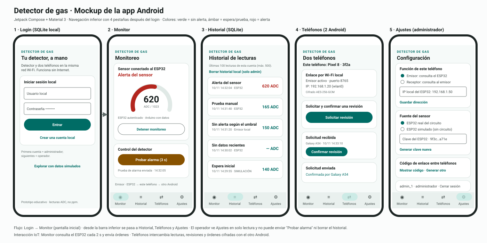

# Detector de gas IoT con Android

Versión 3.0. El monitoreo, el login y el control funcionan en la red Wi-Fi local, incluso sin Internet: las cuentas y las lecturas se guardan en SQLite en cada teléfono. Cuando hay Internet, el emisor respalda las lecturas en **Firebase** (Authentication + Cloud Firestore), y ambos teléfonos pueden consultarlas.

Sumativa Unidad 2 · TI3042 Aplicaciones Móviles para IoT.

## Documentación

| Documento | Contenido | Indicadores |
| --- | --- | --- |
| [docs/DISENO.md](docs/DISENO.md) | Problemática, funcionalidades, herramientas, comunicación inalámbrica, arquitectura, ISO 27400 | 2.1.1.1–2.1.1.4, 2.1.2.5, 2.1.3.10 |
| [docs/mockup.svg](docs/mockup.svg) | Mockup de las 5 pantallas y la navegación | 2.1.2.6 |
| [docs/PLAN_DE_PRUEBAS.md](docs/PLAN_DE_PRUEBAS.md) | Pruebas automatizadas, errores corregidos y pruebas manuales | 2.1.3.11 |
| [GUIA_DE_USO.md](GUIA_DE_USO.md) | Instalación, conexión del circuito y guion de demostración | 2.1.4.12 |



## Abrir el proyecto

1. Clona el repositorio y abre la carpeta `DetectordeGas` en Android Studio.
2. Espera la sincronización. El proyecto conserva SDK 37, Android Gradle Plugin 9.5.0, Gradle 9.6.0 y el JDK 25 de tu Android Studio.
3. Instala la app en dos Android 7.0 o posteriores. Sin circuito puedes usar **Explorar con datos simulados** (un teléfono) o el **ESP32 simulado** del emisor (dos teléfonos enlazados).
4. Sigue `GUIA_DE_USO.md` para conectar el ESP32 y enlazar los teléfonos.

Android Studio puede necesitar Internet para descargar sus herramientas al preparar el proyecto. La aplicación instalada funciona con la red Wi-Fi local sin salida a Internet.

## Componentes

- `MainActivity.kt`: inicio de sesión, monitor, historial, teléfonos y ajustes.
- `DetectorModel.kt`: sesión, roles (administrador/operador), consultas al ESP32, control y enlace local.
- `DetectorData.kt`: SQLite y cliente HTTP del ESP32 con firmas HMAC-SHA256 (`/estado`, `/desafio`, `/prueba`).
- `Simulator.kt`: ESP32 simulado con la lógica del Arduino, para demostrar sin circuito.
- `LocalCrypto.kt`: hashes de contraseñas y cifrado autenticado entre teléfonos.
- `PairingVault.kt`: protección del código de enlace y de la clave del ESP32 con Android Keystore.
- `CloudSync.kt`: Firebase Authentication y Cloud Firestore.
- `firebase/firestore.rules`: reglas de seguridad de Firestore.
- `LocalPeer.kt`: comunicación directa por TCP local, puerto 8765, con mensajes AES-GCM.
- `firmware/ArduinoUno/ArduinoUno.ino`: programa con espera inicial de 5 segundos y umbrales 500/450.
- `firmware/ESP32/ESP32.ino`: lecturas firmadas, orden de prueba hacia el Arduino y marcadores para el Wi-Fi y la clave del dispositivo.

## Arquitectura

```text
MQ-2 → Arduino Uno ⇄ UART ⇄ ESP32
                              ⇅ HTTP firmado (HMAC) en Wi-Fi local
                         Android emisor
                              ⇅ TCP local con mensajes cifrados
                         Android receptor

Cada Android: cuentas locales + historial SQLite
Emisor ──HTTPS/TLS──▶ Firebase (Auth + Firestore) ◀──HTTPS/TLS── Receptor
```

Las conexiones locales solo admiten direcciones IPv4 privadas literales. La única conexión externa es Firebase, opcional y por HTTPS/TLS. El permiso Android `INTERNET` permite utilizar sockets de red, también cuando esa red no tiene salida a Internet.

Las alertas físicas continúan siendo responsabilidad del Arduino. La app monitorea, permite solicitar o confirmar una revisión desde otro Android y controla el detector con **Probar alarma (3 s)**, que activa el LED rojo y el buzzer. Mantén abiertas las dos aplicaciones durante la demostración.
