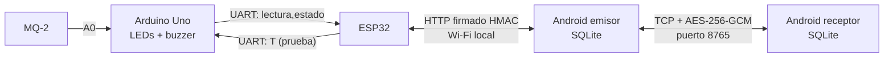

# Diseño del proyecto: Detector de gas IoT con Android

Sumativa Unidad 2 · TI3042 Aplicaciones Móviles para IoT · Versión de la app 2.1-local

## 1. Problemática y dispositivos a conectar

### Problema

Las fugas de gas licuado (GLP) o de gas natural en viviendas, cocinas y laboratorios pueden provocar intoxicaciones, incendios y explosiones. Un detector doméstico solo avisa con un sonido en el lugar; si nadie está cerca, la alerta pasa desapercibida. Además, nadie lleva un registro de cuándo ocurrieron las alertas ni de si alguien revisó el lugar.

### Objetivo de la solución

Monitorear un sensor de gas desde dos teléfonos Android en la misma red Wi-Fi, guardar un historial de lecturas, controlar el detector a distancia (prueba de alarma) y coordinar la revisión entre dos personas. Todo funciona dentro de la red local, sin Internet ni servicios en la nube.

### Dispositivos y sistemas

| Dispositivo | Función | Conexión |
| --- | --- | --- |
| Sensor MQ-2 | Mide gases combustibles (GLP, metano, humo) como valor analógico 0–1023 | Salida analógica a A0 del Arduino |
| Arduino Uno | Lee el sensor, decide la alerta (umbral 500, retorno 450), maneja LED verde (D4), LED rojo (D5) y buzzer (D8) | UART 9600 baudios con el ESP32 |
| ESP32 DevKit V1 | Puerta de enlace Wi-Fi: publica la lectura y recibe órdenes, con firma HMAC-SHA256 | Wi-Fi 2,4 GHz (HTTP en red local) |
| Android emisor | Consulta el ESP32, guarda el historial y comparte la lectura con el otro teléfono | HTTP al ESP32 y TCP cifrado (puerto 8765) |
| Android receptor | Muestra la lectura compartida, guarda su historial, pide pruebas y revisiones | TCP cifrado con el emisor |



Sin el circuito, el emisor puede usar un **ESP32 simulado** que aplica la misma lógica del Arduino. Así se demuestra la comunicación entre los dos Android.

## 2. Funcionalidades clave

| ID | Funcionalidad | Pantalla |
| --- | --- | --- |
| RF01 | Registro e inicio de sesión local con usuario y contraseña | Login |
| RF02 | Roles: la primera cuenta del teléfono es administradora y las siguientes son operadoras | Ajustes |
| RF03 | Monitoreo en tiempo real (cada 2 s) de la lectura ADC y del estado: espera inicial, sin alerta, alerta, prueba o sin datos | Monitor |
| RF04 | Indicador visual por colores (verde, ámbar, rojo) y medidor de 0 a 1023 | Monitor |
| RF05 | Control del detector: **Probar alarma (3 s)** enciende el LED rojo y el buzzer (solo administrador) | Monitor |
| RF06 | Historial local en SQLite: últimas 100 lecturas en pantalla, hasta 500 por cuenta, y borrado con confirmación (solo administrador) | Historial |
| RF07 | Rol del teléfono: emisor (consulta el ESP32) o receptor (consulta al emisor) | Ajustes |
| RF08 | Enlace cifrado entre dos Android mediante un código de 64 caracteres | Ajustes / Teléfonos |
| RF09 | Solicitud de revisión desde un teléfono y confirmación desde el otro | Teléfonos |
| RF10 | Detección de pérdida de datos del Arduino, del ESP32 o del emisor, sin mostrarla como "sin alerta" | Monitor |
| RF11 | Fuente simulada (ESP32 simulado y modo demostración) para probar sin hardware | Ajustes / Login |

Requisitos no funcionales: funciona sin Internet, Android 7.0 (API 24) o superior, interfaz en español y textos que aclaran que las lecturas son ADC y no ppm.

## 3. Herramientas de desarrollo y justificación

| Herramienta | Uso | Justificación |
| --- | --- | --- |
| Android Studio y Gradle (Kotlin DSL) | IDE y compilación | IDE oficial de Android; catálogo de versiones `libs.versions.toml` |
| Kotlin | Lenguaje | Lenguaje recomendado por Google para Android; seguridad frente a nulos y corrutinas |
| Jetpack Compose + Material 3 | Interfaz | Kit de interfaz declarativo recomendado por Android; componentes Material accesibles (NavigationBar, AlertDialog) |
| ViewModel (`AndroidViewModel`) | Arquitectura MVVM | Separa la lógica de la interfaz y conserva el estado al rotar la pantalla |
| Corrutinas y `repeatOnLifecycle` | Consultas periódicas | Las consultas de red no bloquean la interfaz y se pausan cuando la app no está visible |
| SQLite (`SQLiteOpenHelper`) | Cuentas e historial | Incluido en Android, funciona sin conexión y no requiere servidor |
| `HttpURLConnection` y sockets TCP | Comunicación IoT y entre teléfonos | API estándar de Java/Android, sin dependencias externas |
| `javax.crypto` y Android Keystore | Seguridad | Criptografía de la plataforma: PBKDF2, AES-GCM y HMAC-SHA256; la clave maestra queda en el almacén seguro de Android |
| JUnit 4 y AndroidX Test | Pruebas | 22 pruebas unitarias en la JVM y 3 pruebas instrumentadas de SQLite |
| Arduino IDE (núcleo ESP32, mbedTLS) | Firmware | mbedTLS viene incluido en el ESP32 y permite calcular HMAC-SHA256 |

### Elección del almacenamiento y la autenticación

| Opción | Seguridad | Escalabilidad | Facilidad | Funciona sin Internet |
| --- | --- | --- | --- | --- |
| **SQLite local (elegida)** | Hash PBKDF2 con sal por cuenta; los datos no salen del teléfono | Limitada a cada teléfono | Alta: viene en Android | **Sí** |
| Firebase Authentication | Alta, gestionada por Google | Alta | Media: requiere proyecto y google-services | No |
| API REST + MySQL | Depende del backend | Alta | Baja: requiere servidor, TLS y despliegue | No |

Se eligió SQLite porque la demostración se hace en una red local que puede no tener salida a Internet y porque el detector debe seguir funcionando aunque se caiga la conexión externa. La desventaja, que las cuentas no se sincronizan entre teléfonos, se acepta: cada teléfono tiene sus propios usuarios y el enlace entre ambos se autoriza con un código compartido, no con la contraseña.

Interoperabilidad de datos: el ESP32 entrega JSON con un formato fijo (`lectura`, `estado`, `conexion_arduino`, `unidad`), y la app valida rangos y estados antes de guardarlo.

## 4. Comunicación inalámbrica: selección y justificación

| Criterio | Bluetooth clásico / BLE | **Wi-Fi local (elegido)** | MQTT |
| --- | --- | --- | --- |
| Distancia | 10–30 m en interiores; las paredes la reducen | 30–50 m en interiores por router o punto de acceso, ampliable con repetidores | Igual al transporte (Wi-Fi), pero necesita un broker |
| Consumo de energía | Muy bajo (BLE): ideal para baterías | Mayor (~100–240 mA el ESP32 transmitiendo) | Similar al Wi-Fi más las conexiones persistentes |
| Estabilidad | Emparejamiento por teléfono; varias conexiones simultáneas son complejas | Alta: varios clientes a la vez, reconexión automática y direcciones IP fijas | Alta, pero el broker es un punto único de fallo |
| Hardware | El Arduino Uno no tiene Bluetooth; haría falta un módulo HC-05 o usar el BLE del ESP32 | El ESP32 ya incluye Wi-Fi | Requiere un broker (Mosquitto) en otro equipo o en la nube |
| Dos Android a la vez | Cada teléfono necesita su propio enlace | Ambos en la misma red | Sí, mediante suscripción |

**Decisión:** Wi-Fi en una red local, con HTTP firmado entre la app y el ESP32 y TCP cifrado entre los teléfonos.

- **Distancia:** el detector suele estar en la cocina y las personas en otras habitaciones; el Wi-Fi cubre la vivienda completa y Bluetooth no.
- **Energía:** un detector de gas es un dispositivo de seguridad que debe estar siempre encendido y conectado a la red eléctrica, así que el mayor consumo del Wi-Fi no es una limitación. Los teléfonos solo consultan mientras la app está visible.
- **Estabilidad:** el ESP32 atiende varias solicitudes y reintenta la conexión Wi-Fi cada 30 s. La app detecta datos vencidos (más de 3 s sin datos del Arduino o más de 10 s sin datos del emisor) y no los muestra como válidos.
- **MQTT descartado** porque exige un broker adicional que tendría que estar disponible siempre y, si estuviera en la nube, rompería el requisito de funcionar sin Internet.

## 5. Arquitectura del software

```text
app/src/main/java/com/example/detectordegas/
├── MainActivity.kt   Interfaz Compose: Login, Monitor, Historial, Teléfonos, Ajustes
├── DetectorModel.kt  ViewModel: sesión, roles, ciclo de consulta, control y enlace
├── DetectorData.kt   SQLite (cuentas e historial), validación JSON y cliente HTTP firmado del ESP32
├── LocalPeer.kt      Servidor/cliente TCP entre teléfonos (AES-GCM y desafío por conexión)
├── LocalCrypto.kt    PBKDF2, AES-GCM, HMAC-SHA256 y roles
├── PairingVault.kt   Cifrado del código de enlace y de la clave del ESP32 con Android Keystore
└── Simulator.kt      ESP32 simulado con la lógica del Arduino
firmware/ArduinoUno/ArduinoUno.ino  Sensor, umbrales, LEDs, buzzer y comando T
firmware/ESP32/ESP32.ino            Wi-Fi, /estado, /desafio, /prueba con HMAC
```

Flujo de una lectura: `poll()` cada 2 s → `EspClient.status()` (o el simulador) → `Reading.parse()` valida → interfaz + `History.add()` (cada 5 s o al cambiar de estado) → `LocalHub` la publica para el receptor.

## 6. Seguridad según ISO/IEC 27400

ISO/IEC 27400:2022 define controles de seguridad y privacidad para soluciones IoT. La tabla relaciona los controles aplicables con su implementación.

| Control | Implementación | Dónde |
| --- | --- | --- |
| Autenticación de usuarios | Usuario y contraseña de 8 a 128 caracteres; hash PBKDF2 (210 000 iteraciones, sal aleatoria de 16 bytes; HMAC-SHA256 en Android 8+ y SHA1 en Android 7); comparación en tiempo constante | `DetectorData.kt`, `LocalCrypto.kt` |
| Protección contra fuerza bruta | Bloqueo de 30 s tras 5 intentos fallidos; mensaje genérico "usuario o contraseña incorrectos" | `History.login` |
| Control de acceso | Roles administrador/operador comprobados en el ViewModel, no solo en la interfaz. El operador no ve claves ni puede configurar, borrar el historial ni enviar órdenes | `DetectorModel.requireAdmin` |
| Autenticación de dispositivos | Teléfono ↔ ESP32: HMAC-SHA256 con clave de 32 bytes, nonce por consulta y respuesta firmada. Teléfono ↔ teléfono: AES-256-GCM con clave compartida y desafío aleatorio por conexión | `EspClient`, `ESP32.ino`, `LocalPeer.kt` |
| Integridad y protección frente a repeticiones | Etiqueta GCM y HMAC; la orden de control exige un desafío de un solo uso con 10 s de vigencia; los identificadores de mensaje no se aceptan dos veces | `LocalHub`, `ejecutarPrueba()` |
| Cifrado de datos sensibles | Entre teléfonos todo va cifrado. El código de enlace y la clave del ESP32 se guardan cifrados con AES-GCM usando una clave de Android Keystore | `PairingVault.kt` |
| Minimización de la superficie de red | Solo se aceptan IPv4 privadas literales, sin DNS ni redirecciones; respuestas de 8 KB como máximo; el servidor TCP solo acepta clientes de la red local | `privateIp`, `LocalPeerServer` |
| Protección de los datos en el teléfono | `allowBackup=false` y reglas de extracción: la base SQLite no se copia a respaldos en la nube; consultas SQL con parámetros | `AndroidManifest.xml`, `History` |
| Validación de entradas | JSON del ESP32 y del emisor validado: unidad, rango 0–1023, estados permitidos y coherencia entre la lectura y la conexión | `Reading.parse`, `procesarLinea()` |
| Disponibilidad y fallo seguro | La pérdida de datos se muestra como "sin datos", nunca como "sin alerta"; el Arduino mantiene la alarma física aunque fallen la red o la app | `DetectorModel`, `ArduinoUno.ino` |
| Permisos mínimos | Solo `INTERNET`, `ACCESS_NETWORK_STATE` y `ACCESS_LOCAL_NETWORK` (este último se pide en tiempo de ejecución en Android 17) | `AndroidManifest.xml`, `Monitor` |

**Límites declarados:**

- El tramo con el ESP32 usa HTTP autenticado, no cifrado: protege la autenticidad y la integridad, pero no la confidencialidad (la red Wi-Fi WPA2 la protege parcialmente). Se descartó HTTPS en el ESP32 por la gestión de certificados sin una autoridad local. Es la mejora prioritaria para la Unidad 4.
- La clave del ESP32 se escribe en el firmware; en producción se guardaría cifrada en la memoria flash del microcontrolador.
- Es un prototipo educativo: no reemplaza un detector certificado y el MQ-2 no está calibrado en ppm.

## 7. Diseño de la interfaz

El mockup con las cinco pantallas y la navegación está en [mockup.svg](mockup.svg). La navegación inferior tiene cuatro pestañas (Monitor, Historial, Teléfonos y Ajustes) y aparece después de iniciar sesión.

## 8. Retroalimentación del docente

Completar después de cada revisión (indicadores 2.1.1.4 y 2.1.2.7).

| Fecha | Qué se presentó | Observaciones del docente | Ajuste realizado |
| --- | --- | --- | --- |
| | Propuesta: problemática, funcionalidades y herramientas | | |
| | Diseño de la interfaz y estructura de autenticación | | |
| | Demostración final | | |
